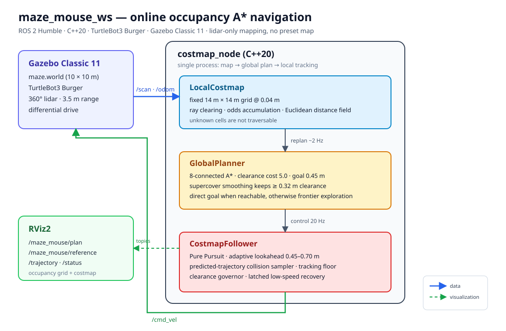
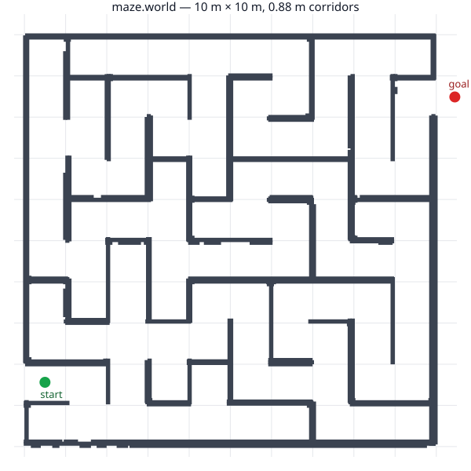
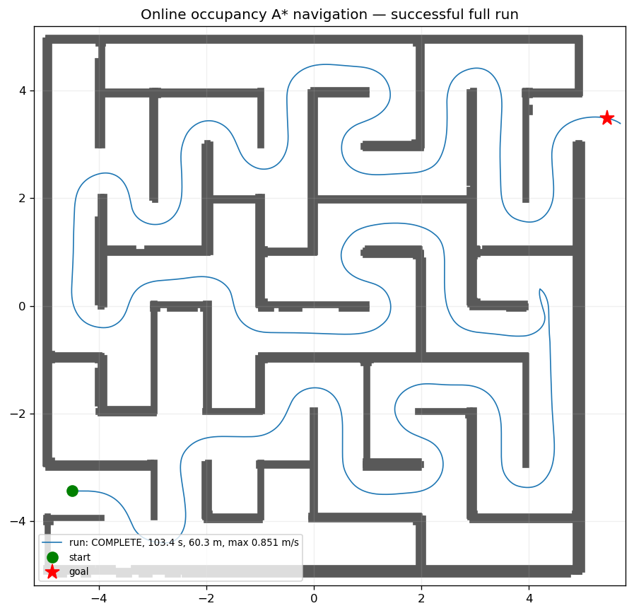

# maze_mouse_ws

[中文](README.md) | [English](README.en.md)

A maze-navigation course project built with **ROS 2 Humble, C++20, Gazebo Classic 11 and the
TurtleBot3 Burger**. The robot builds its own occupancy grid from `/scan` and `/odom`, runs a
global A* search over that grid, explores with frontiers when the goal is unknown, and follows the
resulting path with Pure Pursuit plus a collision-checked local sampler. The controller loads no
world file, maze graph or preset route.

## Robot model

This project uses the **TurtleBot3 Burger** as its Gazebo robot. The model is not authored or
copied into this repository; it is loaded from the ROS 2 Humble `turtlebot3_gazebo` package,
provided by [ROBOTIS-GIT/turtlebot3_simulations](https://github.com/ROBOTIS-GIT/turtlebot3_simulations/tree/humble/turtlebot3_gazebo).

The [maze.launch.py](src/maze_mouse_gazebo/launch/maze.launch.py) launch file sets
`TURTLEBOT3_MODEL=burger` and reads `urdf/turtlebot3_burger.urdf` plus
`models/turtlebot3_burger/model.sdf` from the installed package. Install
`ros-humble-turtlebot3` and `ros-humble-turtlebot3-simulations` before running the simulation.
The project uses the model's differential drive, 360-degree lidar and wheel odometry; the
navigation stack consumes `/scan` and `/odom` and publishes velocity commands on `/cmd_vel`.

This repository contains the maze world, launch configuration and navigation algorithms only. It
does not redistribute the TurtleBot3 model or Gazebo plugins; their meshes, materials, plugins and
other bundled assets remain subject to the licenses supplied by ROBOTIS and the upstream packages.



## What the project does

- **Online mapping** — 360° lidar plus odometry, a fixed 14 m × 14 m occupancy grid at 0.04 m
  resolution; ray clearing accumulates free/occupied evidence and unknown cells are not traversable.
- **Global planning** — 8-connected A* with a strong clearance cost that favours corridor centres.
  If the goal is known and reachable, plan to it directly; otherwise choose a frontier biased
  toward the goal.
- **Path tracking** — Pure Pursuit with adaptive lookahead, curvature preview braking, a
  predicted-trajectory collision sampler, clearance-based speed limiting, a hard tracking floor
  and a low-speed recovery.
- **Safety** — body radius 0.14 m and hard clearance 0.04 m. Planning adds a further
  `planning_margin=0.05 m`, and path shortcuts must keep `smoothing_clearance=0.32 m`.
- **Result** — a full run on the default `maze.world` ends `COMPLETE`: 103.4 s, 60.3 m,
  max measured speed 0.851 m/s, minimum wall clearance 0.240 m, no collisions and no BLOCKED
  transitions.

## Architecture

Data flow:

```text
Gazebo /scan + /odom
        │
        ▼
LocalCostmap ──► GlobalPlanner ──► CostmapFollower ──► /cmd_vel ──► Gazebo
  fixed grid        A* / frontier      Pure Pursuit
  ray clearing      clearance cost     collision sampler
  distance field    path smoothing     speed governor / recovery
        │                                   │
        └──────── /maze_mouse/plan ─────────┴──► RViz2
                  /reference /trajectory /status
```

| Component | File | Responsibility |
| --- | --- | --- |
| `LocalCostmap` | [local_costmap.cpp](src/maze_mouse_navigation/src/local_costmap.cpp) | Fixed global grid, ray clearing, occupancy odds, Euclidean distance field, planning/tracking clearance queries |
| `GlobalPlanner` | [global_planner.cpp](src/maze_mouse_navigation/src/global_planner.cpp) | 8-connected A*, clearance cost, corner-cut rejection, supercover smoothing, frontier selection and replanning policy |
| `CostmapFollower` | [local_costmap.cpp](src/maze_mouse_navigation/src/local_costmap.cpp) | Reference trimming, Pure Pursuit, collision-checked speed sampling, curvature/clearance speed limits, recovery |
| `costmap_node` | [costmap_node.cpp](src/maze_mouse_navigation/src/costmap_node.cpp) | ROS 2 node: subscribes to `/scan` and `/odom`, plans at 2 Hz, controls at 20 Hz, publishes paths/status |
| Gazebo environment | [maze_mouse_gazebo](src/maze_mouse_gazebo/) | Worlds, Burger, TF and RViz launch; default `worlds/maze.world` |

Key design choices:

1. **One fixed map** — 14 m × 14 m covers the default 10 m × 10 m maze and the exit goal. The
   origin defaults to the midpoint of the start and goal.
2. **One map for planning and tracking** — no rolling window that discards history, and no second
   map that can disagree with the planner.
3. **No dead-end handling** — A* only searches observed free space. When the goal is unreachable,
   the planner explores a frontier; an unobserved dead end is exited by the next global replan.
4. **Centre-following paths** — A* clearance weight 5.0 and clearance target 0.45 m; shortcuts
   must keep at least 0.32 m clearance.
5. **Speed governor** — `v ≤ sqrt(2·deceleration·(clearance−tracking_radius)) + 0.05`, which slows
   the robot automatically inside 0.88 m corridors instead of inflating the costmap.
6. **Failure handling** — 15 s without translation enters `FAULT`; no reachable goal and no
   frontier enters `NO_FRONTIER` and stops.

## Repository layout

```text
maze_mouse_ws/
├── README.md                 # Chinese README
├── README.en.md              # English README (this file)
├── docs/
│   ├── architecture.svg      # system diagram
│   ├── maze_world.svg        # top view of the default maze
│   ├── global_run_path.png   # successful full-run trajectory
│   └── validation.md         # results, parameters and reproduction steps
└── src/
    ├── maze_mouse_gazebo/    # Gazebo worlds, Burger, TF, RViz
    └── maze_mouse_navigation/# C++20 global A* + Pure Pursuit navigation
```

## Requirements

- Ubuntu 22.04 (verified on WSL2) or native Linux
- ROS 2 Humble
- Gazebo Classic 11
- TurtleBot3 simulation packages
- CMake 3.22+ and a C++20 compiler

```bash
sudo apt update
sudo apt install gazebo ros-humble-gazebo-ros-pkgs \
  ros-humble-turtlebot3 ros-humble-turtlebot3-simulations
```

## Build

```zsh
cd maze_mouse_ws
source /opt/ros/humble/setup.zsh
colcon build --symlink-install --packages-up-to maze_mouse_navigation
source install/setup.zsh
```

Use `setup.bash` in Bash. 

## Run

Default Gazebo GUI and RViz:

```zsh
ros2 launch maze_mouse_navigation navigation.launch.py
```

Headless (server or automated validation):

```zsh
ros2 launch maze_mouse_navigation navigation.launch.py gui:=false rviz:=false
```

Conservative 0.5 m/s profile:

```zsh
ros2 launch maze_mouse_navigation navigation.launch.py \
  params:=$PWD/src/maze_mouse_navigation/config/costmap_conservative.yaml
```

Gazebo world and robot only:

```zsh
ros2 launch maze_mouse_gazebo maze.launch.py
```

Navigation only, with an existing simulation:

```zsh
ros2 launch maze_mouse_navigation navigation.launch.py simulation:=false
```

Run only one simulation instance at a time; Gazebo uses a single default master port.

## RViz and topics

| Topic | Type | Content |
| --- | --- | --- |
| `/scan` | LaserScan | 360° lidar |
| `/odom` | Odometry | Wheel odometry |
| `/cmd_vel` | Twist | Controller command |
| `/maze_mouse/costmap` | OccupancyGrid | Hard collision inflation (magenta) |
| `/maze_mouse/obstacles` | OccupancyGrid | Raw lidar occupancy |
| `/maze_mouse/plan` | Path | Global A* path (red) |
| `/maze_mouse/reference` | Path | Trimmed tracking reference (green) |
| `/maze_mouse/trajectory` | Path | Actual odometry trajectory (blue) |
| `/maze_mouse/frontier` | PointStamped | Current frontier target; NaN when none |
| `/maze_mouse/status` | String | State, target type, replans, clearance, planner timing |

RViz uses the `odom` fixed frame and displays the robot, TF, laser, costmap, global path, tracking
reference and actual trajectory.

## Key parameters

Defaults are in [costmap.yaml](src/maze_mouse_navigation/config/costmap.yaml); the full table is in
the [navigation package README](src/maze_mouse_navigation/README.md).

| Parameter | Default | Meaning |
| --- | --- | --- |
| `max_linear_speed` / `max_angular_speed` | 1.2 m/s / 1.8 rad/s | Command limits; narrowed by clearance governor |
| `linear_acceleration` / `linear_deceleration` | 1.0 / 1.2 m/s² | Prediction model; deceleration also sets the stopping-distance limit |
| `max_lateral_acceleration` | 0.9 m/s² | Corner speed limit |
| `pursuit_lookahead` / `_gain` / `_max` | 0.45 m / 0.20 s / 0.70 m | Adaptive Pure Pursuit lookahead |
| `costmap_resolution` / `costmap_size` | 0.04 m / 14.0 m | Fixed global grid |
| `robot_radius` / `inflation_margin` | 0.14 m / 0.04 m | Body envelope and hard safety margin |
| `planning_margin` | 0.05 m | Extra clearance required by A* beyond the tracking radius |
| `clearance_cost_weight` / `clearance_target` | 5.0 / 0.45 m | A* clearance cost favouring corridor centres |
| `smoothing_clearance` | 0.32 m | Minimum clearance for path shortcuts |
| `frontier_weight` | 2.5 | Goal-distance weight in frontier scoring |
| `replan_period` | 0.5 s | Global replanning period |

Runtime updates:

```zsh
ros2 param set /maze_navigator max_linear_speed 1.4
ros2 param set /maze_navigator clearance_cost_weight 3.0
ros2 param load /maze_navigator src/maze_mouse_navigation/config/costmap.yaml
```

Changing map size, origin, resolution or laser extrinsics clears the map and waits for the next
scan; other parameters keep the existing map.

## Validation

Default `maze.world` (10 m × 10 m, start `(-4.50,-3.44)`, goal `(5.45,3.49)`):





| Metric | Legacy wall follower | Current global A* + centre preference + speed profile |
| --- | --- | --- |
| Final state | `FAULT` | **`COMPLETE`** |
| Simulated time | 180.4 s | **103.4 s** |
| Odom distance | 60.9 m | 60.3 m |
| Minimum wall clearance | — | **0.240 m** |
| Maximum measured speed | — | **0.851 m/s** |
| BLOCKED transitions | — | 0 |
| Maximum planner time | — | 40.5 ms |

Full results, repeated runs and parameter notes: [docs/validation.md](docs/validation.md).

## Tests and run recording

```zsh
colcon test --packages-select maze_mouse_navigation
colcon test-result --verbose
```

All 31 tests currently pass: map/inflation/sectors, fixed origin, tracking clearance, Pure Pursuit
slew limits, A* around a wall, unreachable goals, frontier selection, and frontier planning in the
6 × 6 maze. The Gazebo package also provides `scripts/validate_maze.py` for static topology and
collision checks.

Record a full run:

```zsh
ros2 launch maze_mouse_navigation navigation.launch.py gui:=false rviz:=false
python3 src/maze_mouse_navigation/tools/record_run.py /tmp/global_run 600
python3 src/maze_mouse_navigation/tools/score_run.py /tmp/global_run
```

`record_run.py` logs `/odom`, `/cmd_vel` and `/maze_mouse/status`; `score_run.py` reports completion,
distance, minimum wall clearance, planner timing and steering variation.

## Troubleshooting

- **Gazebo fails to start / port in use** — stop stale `gzserver`, `robot_state_publisher` or
  `costmap_follower` processes before launching.
- **Headless server** — use `gui:=false rviz:=false`; WSL2 needs a working OpenGL/software
  rendering setup.
- **No topic data** — check the QoS of `/scan` and `/odom`; the controller uses sensor-data QoS.
- **A different maze** — update `start_x/start_y/goal_x/goal_y`, and make sure `costmap_size` and
  `costmap_origin_x/y` cover the start, goal and whole map.
- **Odometry drift** — mapping is odometry-only; there is no SLAM, so long runs accumulate error.
- **Simulation speed is not real-robot speed** — the Gazebo diff-drive accepts a 1.2 m/s command,
  while the stock Burger teleop limit is about 0.22 m/s. The speed profile is for simulation
  experiments.

## Notes and limitations

- Online mapping cannot guarantee zero backtracking: the robot may enter an unobserved dead end.
  The difference is that the next global replan exits it; there is no dead-end/escape/u-turn state
  machine.
- The default controller is `costmap_follower`; `left_wall_follower` and `maze_navigator` remain
  only as historical comparisons and are selected with `controller:=...`.
- TurtleBot3 models and Gazebo plugins come from the installed ROBOTIS simulation packages and
  follow their own licenses.
