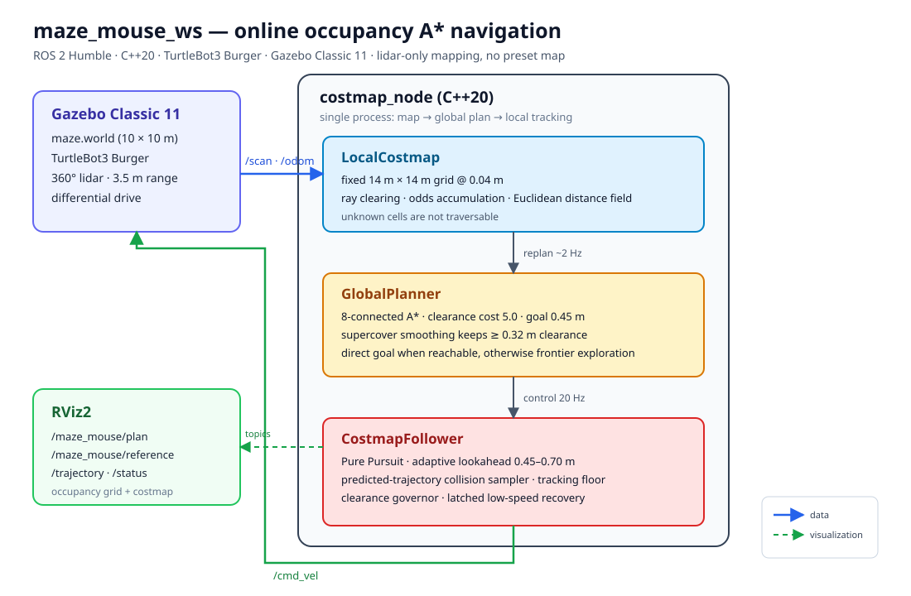
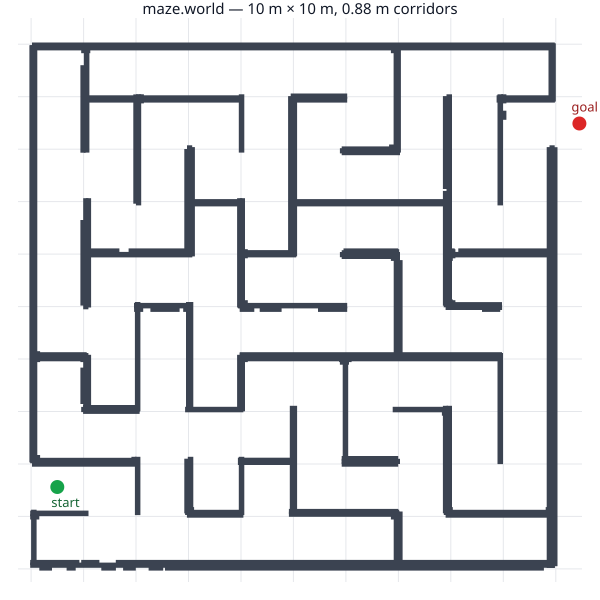
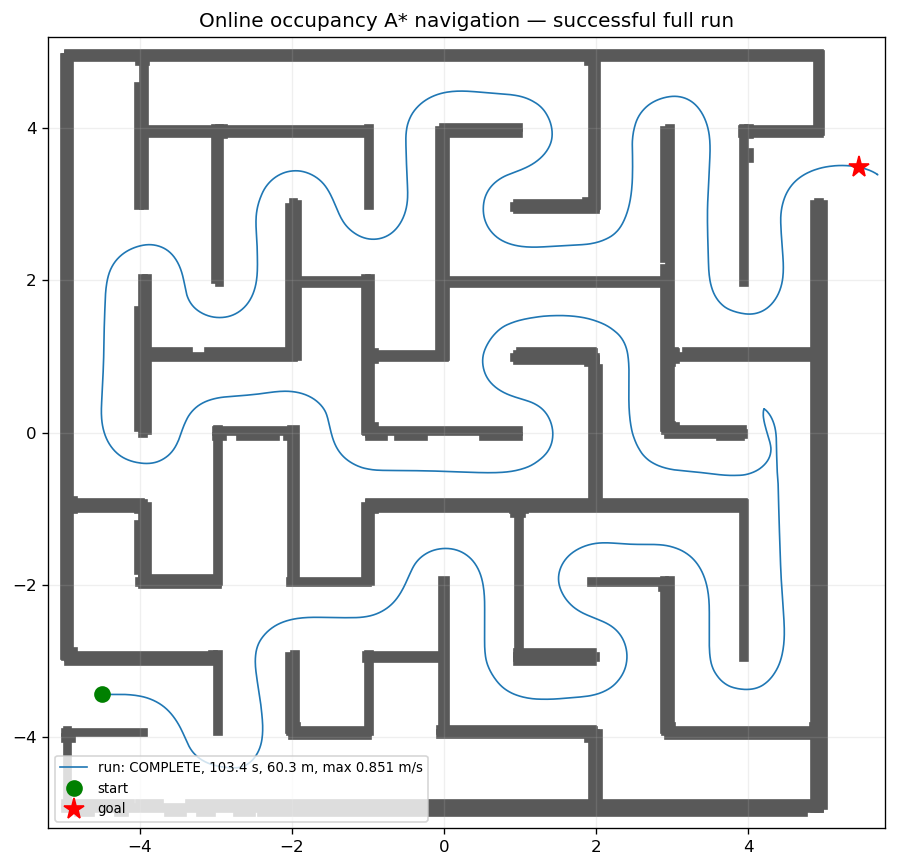

# maze_mouse_ws

[中文](README.md) | [English](README.en.md)

基于 **ROS 2 Humble / C++20 / Gazebo Classic 11 / TurtleBot3 Burger** 的迷宫导航课程项目。
机器人只使用 `/scan` 和 `/odom` 在线建图，在固定占用栅格上做全局 A*，目标未知时用 frontier
探索，再由 Pure Pursuit 跟踪路径并做局部碰撞筛选。控制器不加载 world、迷宫连通图或预设路线。

## 机器人模型说明

本项目在 Gazebo 中使用 **TurtleBot3 Burger** 作为仿真机器人。模型不是本仓库自行制作或复制的，
而是通过 ROS 2 Humble 安装的 `turtlebot3_gazebo` 软件包加载，模型来源为
[ROBOTIS-GIT/turtlebot3_simulations](https://github.com/ROBOTIS-GIT/turtlebot3_simulations/tree/humble/turtlebot3_gazebo)。

启动文件 [maze.launch.py](src/maze_mouse_gazebo/launch/maze.launch.py) 会固定设置
`TURTLEBOT3_MODEL=burger`，并从已安装的软件包读取
`urdf/turtlebot3_burger.urdf` 和 `models/turtlebot3_burger/model.sdf`，因此运行前需要安装
`ros-humble-turtlebot3` 与 `ros-humble-turtlebot3-simulations`。本项目使用模型提供的差速驱动、
360° 激光雷达和轮式里程计，导航算法通过 `/scan`、`/odom` 输入，并向 `/cmd_vel` 输出速度指令。

本仓库只负责迷宫世界、启动配置和导航算法，不重新分发 TurtleBot3 模型或 Gazebo 插件；相关模型、
网格、材质和插件应遵循 ROBOTIS 及其上游软件包附带的许可证。



## 项目内容

- **在线建图**：360° 雷达 + 里程计，固定 14 m × 14 m、0.04 m 分辨率的占据栅格；射线清除自由空间、
  累积占据证据，未知格不参与规划。
- **全局规划**：8 邻接 A*，净空代价强烈偏好走廊中心；目标可达时直接到目标，目标未知/不可达时
  选择朝目标方向的 frontier 探索。
- **路径跟踪**：Pure Pursuit 自适应前瞻、曲率提前减速、碰撞预测速度采样、窄走廊净空限速、
  跟踪半径硬下限和低速脱困。
- **安全约束**：车体半径 0.14 m，硬安全间隙 0.04 m；动态规划在跟踪半径外再保留
  `planning_margin=0.05 m`，路径捷径还必须保持 `smoothing_clearance=0.32 m`。
- **结果**：默认 `maze.world` 全程 `COMPLETE`；最终配置 103.4 s、60.3 m、最大实测 0.851 m/s、
  最小墙净空 0.240 m，无碰撞、无 BLOCKED 切换。

## 项目架构

数据流：

```text
Gazebo /scan + /odom
        │
        ▼
LocalCostmap ──► GlobalPlanner ──► CostmapFollower ──► /cmd_vel ──► Gazebo
  固定栅格          A* / frontier      Pure Pursuit
  射线清除          净空代价           碰撞采样
  距离场            路径平滑           净空限速 / 脱困
        │                                   │
        └──────── /maze_mouse/plan ─────────┴──► RViz2
                  /reference /trajectory /status
```

| 组件 | 文件 | 作用 |
| --- | --- | --- |
| `LocalCostmap` | [local_costmap.cpp](src/maze_mouse_navigation/src/local_costmap.cpp) | 固定全局栅格、射线清除、占据累积、欧氏距离场、跟踪/规划净空查询 |
| `GlobalPlanner` | [global_planner.cpp](src/maze_mouse_navigation/src/global_planner.cpp) | 8 邻接 A*、净空代价、禁止切角、supercover 平滑、frontier 选择与重规划策略 |
| `CostmapFollower` | [local_costmap.cpp](src/maze_mouse_navigation/src/local_costmap.cpp) | 参考路径裁剪、Pure Pursuit、碰撞预测速度采样、曲率限速、净空限速与脱困 |
| `costmap_node` | [costmap_node.cpp](src/maze_mouse_navigation/src/costmap_node.cpp) | ROS 2 节点：订阅 `/scan`、`/odom`，2 Hz 规划、20 Hz 控制，发布路径/状态 |
| Gazebo 环境 | [maze_mouse_gazebo](src/maze_mouse_gazebo/) | 世界、Burger、TF、RViz 启动；默认 `worlds/maze.world` |

关键设计：

1. **固定地图**：14 m × 14 m 覆盖默认 10 m × 10 m 迷宫和出口目标；地图原点默认取起点/目标中点。
2. **一个规划器**：`LocalCostmap` 同时服务规划与跟踪，避免滚动窗口丢历史、也避免两套地图不一致。
3. **不处理死胡同**：A* 只在已观测可通行区域搜索；目标不可达时选 frontier，进入未观测死胡同后
   由下一次全局重规划退出。
4. **中心路径**：A* 净空权重 5.0、目标净空 0.45 m；平滑捷径至少保持 0.32 m 净空。
5. **安全限速**：`v ≤ sqrt(2·deceleration·(clearance−tracking_radius)) + 0.05`，在 0.88 m 通道内
   自动降速；不靠把膨胀层做大来“保证安全”。
6. **故障处理**：15 s 无平移进入 `FAULT`；没有可达目标且没有 frontier 时进入 `NO_FRONTIER` 并停车。

## 目录结构

```text
maze_mouse_ws/
├── README.md                 # 中文说明（本文件）
├── README.en.md              # English README
├── docs/
│   ├── architecture.svg      # 系统架构图
│   ├── maze_world.svg        # 默认迷宫俯视图
│   ├── global_run_path.png   # 成功全程轨迹
│   └── validation.md         # 验证数据、参数与复现命令
└── src/
    ├── maze_mouse_gazebo/    # Gazebo 世界、Burger、TF、RViz
    └── maze_mouse_navigation/# C++20 全局 A* + Pure Pursuit 导航
```

## 环境要求

- Ubuntu 22.04（本项目在 WSL2 上验证）或原生 Linux
- ROS 2 Humble
- Gazebo Classic 11
- TurtleBot3 仿真包
- CMake 3.22 或更新，C++20 编译器

```bash
sudo apt update
sudo apt install gazebo ros-humble-gazebo-ros-pkgs \
  ros-humble-turtlebot3 ros-humble-turtlebot3-simulations
```

## 编译

```zsh
cd maze_mouse_ws
source /opt/ros/humble/setup.zsh
colcon build --symlink-install --packages-up-to maze_mouse_navigation
source install/setup.zsh
```

Bash 终端把 `setup.zsh` 换成 `setup.bash`。

## 运行

默认带 Gazebo GUI 和 RViz：

```zsh
ros2 launch maze_mouse_navigation navigation.launch.py
```

无界面（服务器/自动验证）：

```zsh
ros2 launch maze_mouse_navigation navigation.launch.py gui:=false rviz:=false
```

使用 0.5 m/s 保守速度配置：

```zsh
ros2 launch maze_mouse_navigation navigation.launch.py \
  params:=$PWD/src/maze_mouse_navigation/config/costmap_conservative.yaml
```

只启动 Gazebo 世界和机器人（不启动导航）：

```zsh
ros2 launch maze_mouse_gazebo maze.launch.py
```

已有仿真、只启动导航：

```zsh
ros2 launch maze_mouse_navigation navigation.launch.py simulation:=false
```

同一时刻只运行一个使用默认 Gazebo master 端口的仿真实例。

## RViz 与话题

| 话题 | 类型 | 内容 |
| --- | --- | --- |
| `/scan` | LaserScan | 360° 雷达 |
| `/odom` | Odometry | 里程计 |
| `/cmd_vel` | Twist | 控制器输出 |
| `/maze_mouse/costmap` | OccupancyGrid | 硬碰撞边界膨胀，RViz 洋红色 |
| `/maze_mouse/obstacles` | OccupancyGrid | 雷达原始占据 |
| `/maze_mouse/plan` | Path | 全局 A* 路径（红色） |
| `/maze_mouse/reference` | Path | 裁剪后的跟踪参考（绿色） |
| `/maze_mouse/trajectory` | Path | 实际轨迹（蓝色） |
| `/maze_mouse/frontier` | PointStamped | 当前 frontier；无 frontier 时为 NaN |
| `/maze_mouse/status` | String | 状态/目标类型/重规划/净空/规划耗时等 JSON |

RViz 默认固定坐标 `odom`，显示机器人、TF、雷达、costmap、全局路径、跟踪参考和实际轨迹。

## 关键参数

默认配置见 [costmap.yaml](src/maze_mouse_navigation/config/costmap.yaml)；完整参数表见
[导航包 README](src/maze_mouse_navigation/README.md)。

| 参数 | 默认值 | 含义 |
| --- | --- | --- |
| `max_linear_speed` / `max_angular_speed` | 1.2 m/s / 1.8 rad/s | 指令上限；窄走廊由净空限速进一步降低 |
| `linear_acceleration` / `linear_deceleration` | 1.0 / 1.2 m/s² | 预测模型；deceleration 也用于停止距离限速 |
| `max_lateral_acceleration` | 0.9 m/s² | 弯道横向加速度上限 |
| `pursuit_lookahead` / `_gain` / `_max` | 0.45 m / 0.20 s / 0.70 m | Pure Pursuit 自适应前瞻 |
| `costmap_resolution` / `costmap_size` | 0.04 m / 14.0 m | 固定全局栅格 |
| `robot_radius` / `inflation_margin` | 0.14 m / 0.04 m | 车体包络与硬安全间隙 |
| `planning_margin` | 0.05 m | A* 在跟踪半径外额外保留的净空 |
| `clearance_cost_weight` / `clearance_target` | 5.0 / 0.45 m | A* 净空代价，强偏走廊中心 |
| `smoothing_clearance` | 0.32 m | 路径捷径必须保持的净空 |
| `frontier_weight` | 2.5 | frontier 评分中到目标距离的权重 |
| `replan_period` | 0.5 s | 全局重规划周期 |

运行中修改示例：

```zsh
ros2 param set /maze_navigator max_linear_speed 1.4
ros2 param set /maze_navigator clearance_cost_weight 3.0
ros2 param load /maze_navigator src/maze_mouse_navigation/config/costmap.yaml
```

修改地图尺寸、origin、分辨率或激光外参会清空地图并等待下一帧扫描；修改其余参数保留已建地图。

## 验证结果

默认 `maze.world`（10 m × 10 m，起点 `(-4.50,-3.44)`，目标 `(5.45,3.49)`）：





| 指标 | 旧左墙控制器 | 当前全局 A* + 中心偏好 + 提速 |
| --- | --- | --- |
| 结束状态 | `FAULT` | **`COMPLETE`** |
| 仿真时间 | 180.4 s | **103.4 s** |
| 里程 | 60.9 m | 60.3 m |
| 最小墙净空 | — | **0.240 m** |
| 最大实测速度 | — | **0.851 m/s** |
| BLOCKED 切换 | — | 0 |
| 最大规划耗时 | — | 40.5 ms |

完整数据、多次运行和参数说明见 [docs/validation.md](docs/validation.md)。

## 测试与记录

```zsh
colcon test --packages-select maze_mouse_navigation
colcon test-result --verbose
```

当前 31 个测试通过：地图/膨胀/扇区、固定原点、跟踪净空、Pure Pursuit 限幅、A* 绕墙、
目标不可达、frontier 选择、六乘六迷宫 frontier 规划等。Gazebo 环境还提供
`scripts/validate_maze.py` 做静态拓扑/碰撞检查。

记录一次完整运行：

```zsh
ros2 launch maze_mouse_navigation navigation.launch.py gui:=false rviz:=false
python3 src/maze_mouse_navigation/tools/record_run.py /tmp/global_run 600
python3 src/maze_mouse_navigation/tools/score_run.py /tmp/global_run
```

`record_run.py` 记录 `/odom`、`/cmd_vel`、`/maze_mouse/status`；`score_run.py` 输出完成状态、
里程、最小墙净空、规划耗时和转向变化。

## 常见问题

- **Gazebo 起不来 / 端口占用**：确认没有旧的 `gzserver`、`robot_state_publisher` 或
  `costmap_follower` 进程；先结束旧实例再启动。
- **无界面服务器**：使用 `gui:=false rviz:=false`；WSL2 下需要可用的 OpenGL/软件渲染环境。
- **话题没有数据**：检查 `/scan`、`/odom` 的 QoS；导航节点使用传感器 QoS 订阅。
- **换一张迷宫**：同步修改 `start_x/start_y/goal_x/goal_y`，并确认 `costmap_size` 与
  `costmap_origin_x/y` 覆盖起点、目标和整张地图。
- **里程计漂移**：当前只用里程计建图，未接入 SLAM；长时间运行会累积误差。
- **仿真速度不等于实车速度**：Gazebo 的 diff-drive 插件接收 1.2 m/s 指令，但真实 Burger 的
  官方遥控上限约 0.22 m/s；本项目的速度参数用于仿真实验对比。

## 说明与限制

- 在线建图不保证零回头路：仍可能进入尚未观测的死胡同；区别是退出由同一次全局重规划完成，
  没有 dead-end/escape/u-turn 专用状态机。
- 默认控制器是 `costmap_follower`；`left_wall_follower` 和 `maze_navigator` 仅保留为历史对照，
  通过 `controller:=...` 切换。
- TurtleBot3 模型和 Gazebo 插件来自已安装的 ROBOTIS 仿真包，遵循其自身许可证。
