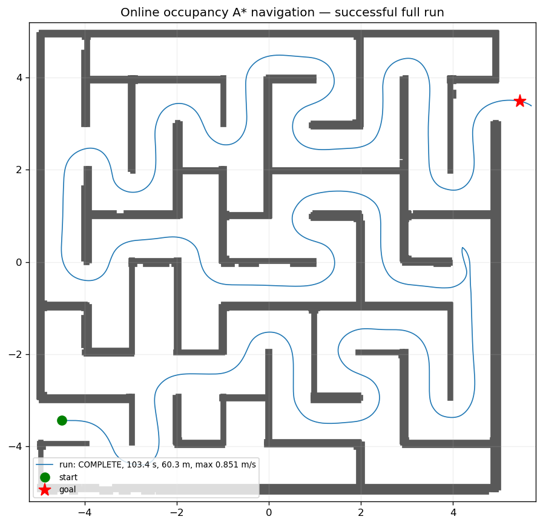

# 全局 A* + 前沿探索验证记录

## 方案

默认 `costmap_follower` 不再使用左墙/死胡同状态机：

1. `/scan + /odom` 在固定 14 m × 14 m、0.04 m 占据栅格上累积障碍与自由空间。
2. 每次规划在同一张图上做 8 邻接 A*：可通过格要求 `tracking_clearance > tracking_radius + planning_margin`（默认 0.05 m），
   禁止切角，并按净空加权（权重 5.0，目标净空 0.45 m）；路径用 free 网格上的 supercover 捷径平滑，
   捷径必须保持 `smoothing_clearance=0.32 m`，因此路径贴近走廊中心而不是贴墙。
3. 目标格未知/不可达时，在所有可达 frontier 中按 `g + 2.5·distance(frontier, goal)` 选择，
   带粘滞与切换滞回；目标格变为可达后自动改为直达目标。
4. Pure Pursuit 跟踪全局路径，跟踪层保留碰撞采样、净空限速、跟踪半径下限和低速脱困；
   不再有 `dead_end/escape/closed_branch/u_turn` 专用分支。

## 结果

对照基线（同一 `maze.world`，1.0 m/s 配置）：

| 指标 | 左墙 + 死胡同 | A* 初版（两次） | A* 中心偏好 + 提速（最终） |
| --- | --- | --- | --- |
| 结束状态 | `FAULT`（15 s 无平移） | `COMPLETE` / `COMPLETE` | **`COMPLETE`** |
| 仿真时间 | 180.4 s（故障前） | 110.4 s / 110.8 s | **103.4 s** |
| 里程 | 60.9 m | 56.1 m / 56.1 m | 60.3 m |
| 死胡同/支路绕行 | 9 次 | 0 | 0 |
| 最小墙净空 | — | 0.172 m / 0.180 m | **0.240 m** |
| 最大实测速度 | — | — | **0.851 m/s** |
| 规划耗时 | — | 最大 48.8 ms / 31.0 ms | 最大 40.5 ms |
| 重规划 | — | 247 / 245 次 | 231 次 |
| BLOCKED 次数 | — | 1 / 0 | 0 |

最终配置：`planning_margin=0.05`（A* 允许使用更紧的空间）、
`clearance_cost_weight=5.0`、`clearance_target=0.45`、
`smoothing_clearance=0.32`（捷径也必须保持中心净空）；速度配置为
`max_linear_speed=1.2`、`linear_deceleration=1.2`、
`max_lateral_acceleration=0.9`、`pursuit_lookahead=0.45`。
路径仍贴近走廊中心（最小墙净空 0.240 m），最大实测速度从约 0.73 m/s 提高到 0.851 m/s，
完成时间从 114.4 s 降到 103.4 s。0.88 m 通道内的实际速度仍由净空停止距离和弯道横向加速度限制。



前 100 s 主要在探索未知区域；最终配置在约 100 s 目标格变为可达，`planner_target`
从 `frontier` 切换为 `goal`，随后在 103.4 s 到达 `(5.48, 3.48)`，全程 BLOCKED 0，
最小墙净空 0.240 m，最大实测速度 0.851 m/s。仅启用中心偏好、未提速的那次运行在
114.4 s 到达，最小净空 0.265 m、里程 62.0 m。

## 复现

```zsh
source /opt/ros/humble/setup.zsh
colcon build --symlink-install --packages-up-to maze_mouse_navigation
source install/setup.zsh
ros2 launch maze_mouse_navigation navigation.launch.py gui:=false rviz:=false
# 另一终端
python3 src/maze_mouse_navigation/tools/record_run.py /tmp/global_run 600
python3 src/maze_mouse_navigation/tools/score_run.py /tmp/global_run
```

评分输出应包含 `state=COMPLETE`、`planner_target=goal`、`no_frontier=0`，
且 `min_wall_clearance_m > 0.14`。

## 说明

在线建图仍可能进入尚未观测的死胡同；区别是退出由同一次全局重规划完成，没有专用状态机。
当前使用里程计维护地图，未接入 SLAM；长时间累计漂移会影响固定图。旧左墙/死胡同调参记录
已从仓库清理，当前默认行为的验证以本文件为准。
