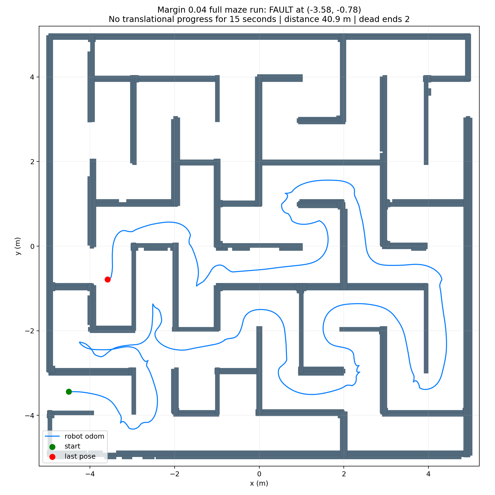

# 0.18 m hard inflation: full-run diagnosis

## Configuration

- Robot footprint radius: 0.14 m.
- Hard inflation margin: 0.04 m.
- Resulting hard clearance radius: 0.18 m.
- Soft-cost radius: 0.28 m.
- Command speed limit: 0.50 m/s.
- With 0.88 m clear corridors, the nominal width available to the robot
  reference point is 0.52 m after hard inflation on both sides.

## Simulation result

The full-maze run using `worlds/maze.world` traveled 40.94 m and detected two
dead ends, then stopped at approximately `(-3.585, -0.783)` and entered the
15-second no-translational-progress fault. It did not reach the exit.

At the final stop the costmap clearance was 0.242 m, while the front, left,
and right laser sector distances were 1.409 m, 1.019 m, and 1.697 m. These
measurements exceed the 0.18 m hard radius by a clear margin. This stop was
therefore not caused by the inflated footprint touching a wall or by a
detected dead end.

The navigation telemetry showed a short/unstable local reference and a
controller tracking error while the trajectory sampler could not settle on a
valid forward command. Repeated stationary turning did not make translational
progress, so the watchdog stopped the run. The earlier failure near
`(-4.328, -2.203)` had the same broad symptom: the robot had room from walls,
but the local path/controller became trapped before the progress watchdog
expired. The current controller recovery changes let the robot pass that
earlier point, but exposed a later failure elsewhere.

## Path plot

The recorded path for the 0.18 m inflation run is shown below.

The run is diagnostic rather than a successful end-to-end validation. The
next controller change should preserve a consistent local reference through
corners and avoid repeatedly changing turn direction when the forward
trajectory sampler rejects its candidates.
