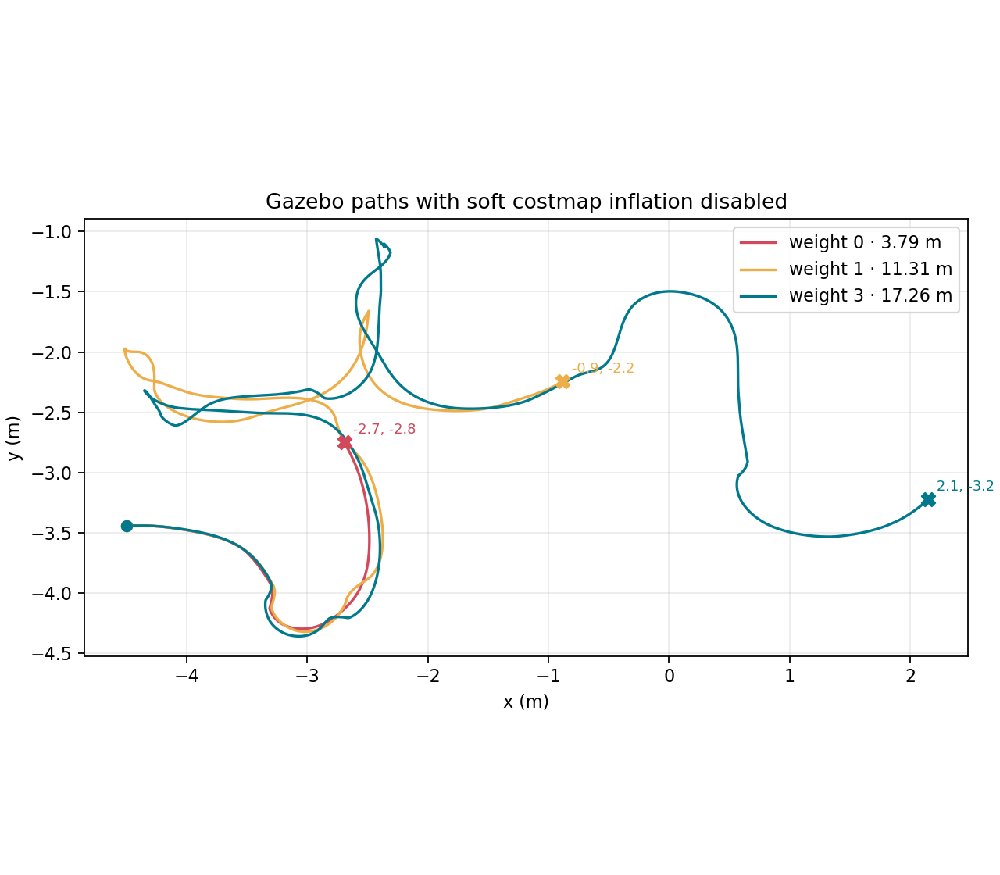

# Soft inflation disabled: repeated stop diagnosis

## Setup

All three Gazebo runs used `worlds/maze.world`, Burger, a 0.50 m/s speed cap,
0.18 m hard collision radius (0.14 m robot radius + 0.04 m margin), and
`soft_cost_radius: 0.0`. The OccupancyGrid no longer publishes a soft-cost
band. The trials varied only the local trajectory clearance preference to
separate costmap inflation from trajectory scoring.

| Trial | Trajectory clearance weight | Distance | Stop position (m) | Map clearance (m) | Front / left / right (m) | Tracking error | Result |
| --- | ---: | ---: | --- | ---: | --- | ---: | --- |
| 1 | 0 | 3.79 m | (-2.694, -2.751) | 0.177 | 1.183 / 0.337 / 1.286 | -0.987 rad | 15 s no-progress fault ([params](soft_inflation_trials/trial1.yaml), [data](soft_inflation_trials/trial1.result.json), [log](soft_inflation_trials/trial1.status.jsonl)) |
| 2 | 1 | 11.31 m | (-0.881, -2.243) | 0.175 | 1.043 / 0.379 / 0.769 | -1.219 rad | 15 s no-progress fault ([params](soft_inflation_trials/trial2.yaml), [data](soft_inflation_trials/trial2.result.json), [log](soft_inflation_trials/trial2.status.jsonl)) |
| 3 | 3 | 17.26 m | (2.148, -3.222) | 0.177 | 0.966 / 0.392 / 1.508 | -1.020 rad | 15 s no-progress fault ([params](soft_inflation_trials/trial3.yaml), [data](soft_inflation_trials/trial3.result.json), [log](soft_inflation_trials/trial3.status.jsonl)) |

## Diagnosis

The same stop reason occurred in three different places. The front and at
least one side were open at each stop, so these were not dead ends. At every
stop the reported costmap clearance was about 3–5 mm below the 0.18 m hard
radius; the controller therefore had no normal forward trajectory to accept.
The robot was already stopped safely and had not reported a collision.

The run telemetry points to a local path/controller trap: tracking error was
about 1 rad, the effective control lookahead had collapsed to 0.24–0.28 m, and
the state alternated through `BLOCKED`, `RECOVER_CLEARANCE`, and
`WAIT_FOR_DATA` before the 15-second no-progress watchdog faulted. Raising the
trajectory clearance preference increased distance before stopping (3.79 m,
11.31 m, 17.26 m), but did not complete the maze. This preference is applied
only when ranking predicted trajectories; it does not add cells to the
costmap inflation layer.

This shows that disabling the costmap soft layer alone does not fix parking.
The remaining failure is that the local controller gets too close to its hard
limit and cannot recover a consistent path, even with free space visible in
the laser sectors. The full-map run is still incomplete; these are controlled
diagnostic trials, not a successful navigation result.

## Automated checks

The package builds, and the new focused test `Costmap.ZeroSoftRadiusPublishesOnlyHardObstacles` passes. The full package test suite is not clean: core and left-wall suites pass, while four existing costmap cases fail, including the noisy full-world controller run. These failures are retained as a limitation rather than hidden by treating the Gazebo trials as a pass.
